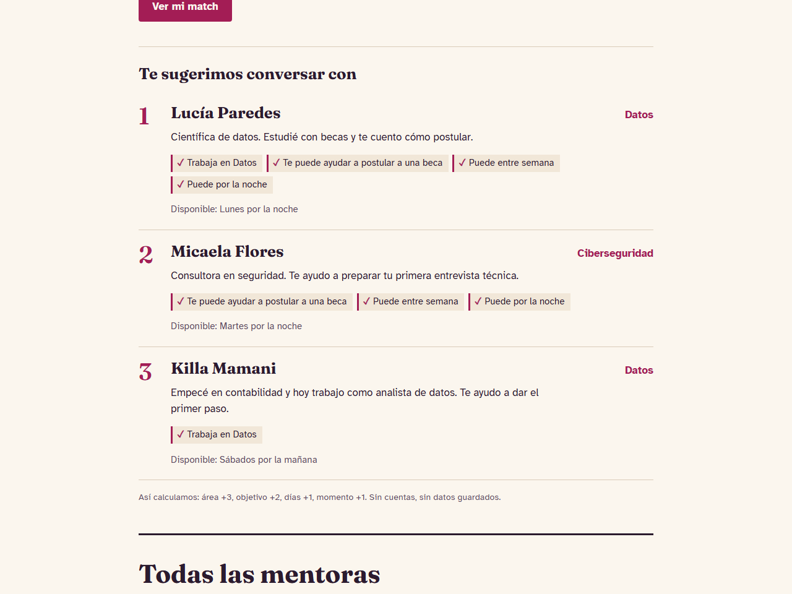

# Warmi Mentoras

> **Warmi Innovathon 2026** · Demo del taller (no es la solución al reto de ningún equipo)
> Equipo: **Equipo demo** (ficticio) · Mentora: **organización del taller** · Demo: **[dav082004.github.io/WarmiInnovatho-Demo](https://dav082004.github.io/WarmiInnovatho-Demo/)**

<!--
  Este README sigue, sección por sección, la plantilla docs/PLANTILLA-README.md del kit:
  https://github.com/Dav082004/WarmiInnovathon-
  Así se ve un README de equipo completo. Todas las mentoras son ficticias.
-->

> 💡 **¿Vienes del taller?** Este repo se creó con la [plantilla del kit](https://github.com/Dav082004/WarmiInnovathon-) y muestra el recorrido completo de **Spec-Driven Development**: cómo una idea se vuelve spec, plan, tareas divididas por área, código con pruebas y demo publicada. El guion paso a paso está en [docs/COMO-SE-HIZO.md](docs/COMO-SE-HIZO.md). Este README es un **ejemplo del README que completará tu equipo**.


## El problema

Muchas mujeres que quieren empezar en tecnología no conocen a ninguna mujer que trabaje en el rubro. Sin un referente a quien preguntarle, es más fácil abandonar antes de empezar. Y cuando buscan ayuda, se topan con jerga ("UX", "backend") que no saben ni cómo buscar.

## Nuestra solución

Un sitio de mentoras voluntarias con dos entradas: **Mi match**, que en 3 preguntas en lenguaje simple sugiere hasta 3 mentoras y explica por qué; y un **directorio** con filtros para quien ya sabe qué busca.

**¿Para quién es?** Mujeres que empiezan en tecnología, entran desde el celular y no necesariamente conocen la jerga del sector.

**¿Qué la hace distinta?**

- **No te pide que busques: te pregunta qué necesitas.** Cada área se explica en una frase.
- **Cada sugerencia dice por qué.** Cuatro reglas a la vista, no una caja negra: la ONG puede leerlas y ajustarlas.
- **Privacidad por diseño.** Sin cuenta y sin servidor: las respuestas no salen del celular.
- **La ONG la mantiene sin programar:** agregar una mentora es editar un archivo, y la CI avisa si se equivoca.

## Demo

**[dav082004.github.io/WarmiInnovatho-Demo](https://dav082004.github.io/WarmiInnovatho-Demo/)** (se publica sola en cada merge a `main`).

Pruébala en 3 pasos:

1. En **Mi match** elige *Datos*, *Postular a una beca* y *Entre semana · Por la noche*. Pulsa **Ver mi match**.
2. Lucía Paredes aparece primera, con sus 4 razones (área, objetivo, días y momento).
3. Baja al **directorio**, elige *Desarrollo web* y escribe "react": queda Valeria Torres. Escribe algo que no exista y aparece el botón para volver a ver todas.



## Funcionalidades

Cada una con los requisitos (RF) de la spec que cumple.

**Spec 001 · Directorio**

- [x] Lista de mentoras en orden alfabético, con su disponibilidad (RF-1)
- [x] Filtro por área (RF-2)
- [x] Búsqueda por nombre o tema, sin distinguir mayúsculas ni tildes, combinable con el área (RF-3, RF-4)
- [x] Mensaje y botón cuando no hay resultados (RF-5)
- [x] Contador de resultados (RF-6)
- [ ] Compartir una mentora por WhatsApp (RF-7) · **pendiente a propósito para hacerla en vivo**

**Spec 002 · Mi match**

- [x] Hasta 3 mentoras sugeridas, de mayor a menor compatibilidad (RF-8)
- [x] Puntaje transparente: área +3, objetivo +2, días +1, momento +1 (RF-9)
- [x] Empates en orden alfabético (RF-10)
- [x] Una razón por cada criterio que sumó (RF-11)
- [x] Mensaje y enlace al directorio si nadie coincide (RF-12)

El detalle está en las specs: [`001-directorio-mentoras`](specs/001-directorio-mentoras/spec.md) y [`002-mi-match`](specs/002-mi-match/spec.md).

## Tecnologías

| Parte | Herramienta |
| --- | --- |
| Frontend | HTML, CSS y JavaScript (módulos ES), sin frameworks |
| Backend / datos | Sin servidor: dos archivos JSON (`data/mentoras.json` y `data/catalogo.json`) |
| Pruebas | `node --test`, incluido en Node |
| Despliegue | GitHub Pages con GitHub Actions |
| IA | GitHub Copilot u OpenCode + MCP de GitHub |

## Cómo ejecutarlo

Necesitas [Node](https://nodejs.org/es/download) 20 o superior. No hay dependencias que instalar.

```bash
git clone https://github.com/Dav082004/WarmiInnovatho-Demo.git
cd WarmiInnovatho-Demo
npm start     # abre http://localhost:3000
npm test      # corre las 28 pruebas
```

¿Primera vez configurando Git, VS Code o el agente? Sigue la [Parte 1 del README del kit](https://github.com/Dav082004/WarmiInnovathon-#parte-1--configura-tu-computadora-paso-a-paso).

## Cómo lo construimos

Usamos **Spec-Driven Development**: primero acordamos qué construir en una spec, y de ahí salen el plan, las tareas, el código y las pruebas. El paso a paso, con lo que se le pidió a cada agente: [docs/COMO-SE-HIZO.md](docs/COMO-SE-HIZO.md).

| Fase | Dónde quedó |
| --- | --- |
| Principios | [docs/constitution.md](docs/constitution.md) |
| Requisitos | [spec 001](specs/001-directorio-mentoras/spec.md) y [spec 002](specs/002-mi-match/spec.md) |
| Plan y tareas | [plan 001](specs/001-directorio-mentoras/plan.md) · [tareas 001](specs/001-directorio-mentoras/tasks.md) · [plan 002](specs/002-mi-match/plan.md) · [tareas 002](specs/002-mi-match/tasks.md) |
| Código | Lógica: [js/mentoras.js](js/mentoras.js), [js/match.js](js/match.js) · Vista: [js/app.js](js/app.js), [js/vista-match.js](js/vista-match.js) |
| Pruebas | [tests/](tests/) (una o más por RF, más la integridad de los datos) y la [CI](.github/workflows/ci.yml) |
| Despliegue | [pages.yml](.github/workflows/pages.yml): no publica si las pruebas fallan |
| Pitch | [docs/pitch.md](docs/pitch.md) |

| Spec | Qué agrega | RF | Estado |
| --- | --- | --- | --- |
| [001 · Directorio](specs/001-directorio-mentoras/spec.md) | Lista, filtros y búsqueda | RF-1 a RF-7 | Implementada salvo RF-7 |
| [002 · Mi match](specs/002-mi-match/spec.md) | Sugerencias explicables en 3 preguntas | RF-8 a RF-12 | Implementada |

## Cómo nos dividimos el trabajo

Tablero: GitHub Projects con *Por hacer, En progreso, En revisión, Hecho* y los campos Área, RF y Tarea (se arma en vivo en el taller).

Cada persona lidera un área (decide y revisa los PRs de esa área) y todas abren al menos un PR. Equipo **ficticio**, para el ejemplo; el reparto de la spec 002, con dependencias y olas en paralelo, está en [tasks.md](specs/002-mi-match/tasks.md#orden-de-trabajo).

| Nombre | Lidera | Tareas | GitHub |
| --- | --- | --- | --- |
| Ana | Diseño y Frontend | T5, T8, T12 | (ficticia) |
| Lucía | Backend y datos | T2, T3, T9, T13 | (ficticia) |
| Mayu | Docs y pitch | T4, T10, T14 | (ficticia) |
| Sumaq | Pruebas | T1, T6, T11 | (ficticia) |

## Cómo trabajamos

- `main` siempre funciona, y todo entra por pull request revisado por una compañera.
- Una tarea = un issue = una rama. El tablero dice quién hace qué.
- La IA propone, una persona decide.

Reglas completas: [CONTRIBUTING.md](CONTRIBUTING.md) para personas y [AGENTS.md](AGENTS.md) para la IA. El flujo, en [docs/FLUJO-SDD.md](docs/FLUJO-SDD.md).

## Checklist de entrega (domingo 15, 11:59 p. m.)

- [x] README completo (problema, solución, demo, equipo)
- [x] `main` funciona: se puede clonar y ejecutar con los pasos de arriba
- [ ] Cada requisito de la spec tiene su prueba y la CI está en verde · *falta RF-7, a propósito*
- [ ] Todas las integrantes tienen al menos un PR revisado y fusionado · *equipo ficticio*
- [x] Enlace a la demo funcionando
- [x] Sin contraseñas, claves ni datos personales reales en el repo
- [x] Repositorio público
- [x] `docs/pitch.md` listo para la final del lunes 16

---

Hecho para el taller de la Warmi Innovathon 2026, con el apoyo de Ubuntu, Makipuray, Microsoft y GitHub Education. Créditos de las skills en [NOTICE.md](NOTICE.md).
