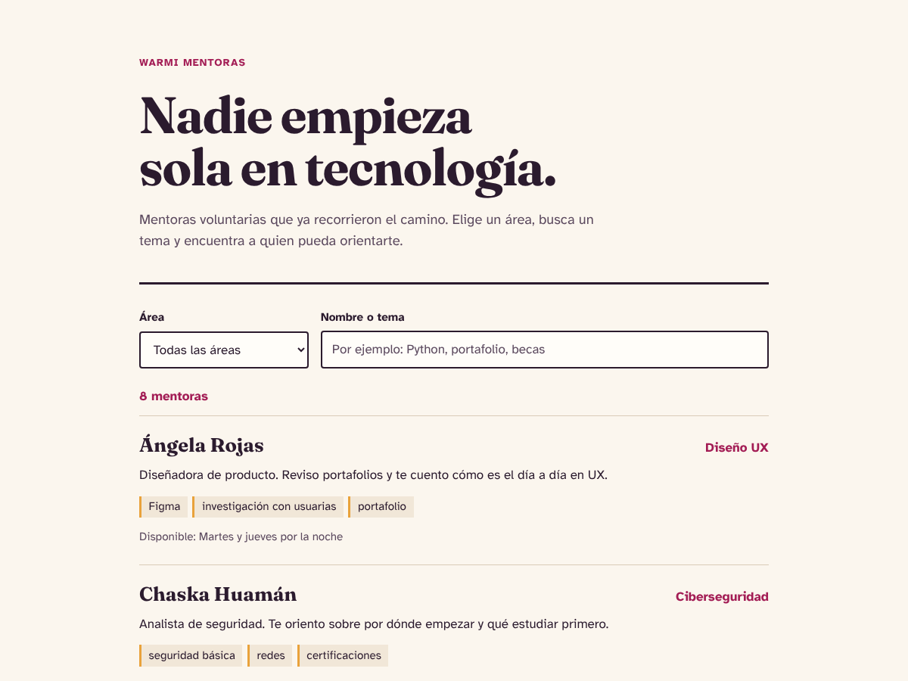

# Warmi Mentoras

> **Demo del taller de la Warmi Innovathon 2026.** Este repositorio muestra cómo se usa la [plantilla](https://github.com/Dav082004/WarmiInnovathon-) para llevar una idea desde la spec hasta la demo publicada.
> La idea es un ejemplo inspirado en el propósito del evento (reducir la brecha de género en tecnología); no es la solución al reto de ningún equipo. Todas las mentoras son ficticias.



## El problema

Muchas mujeres que quieren empezar en tecnología no conocen a ninguna otra mujer que trabaje en el rubro. Sin un referente cercano a quien preguntarle, es más fácil abandonar antes de empezar.

## Nuestra solución

Un directorio web de mentoras voluntarias. La aprendiz elige un área, busca un tema y encuentra en menos de un minuto a alguien que ya recorrió el camino y dice cuándo está disponible.

**¿Para quién es?** Mujeres que empiezan en tecnología y entran desde el celular.

**¿Qué la hace distinta?** No es un curso más: es el primer contacto humano. Y la ONG puede mantenerla sin programar, editando un solo archivo.

## Demo

https://dav082004.github.io/WarmiInnovatho-Demo/ (se publica sola en cada merge a `main`, una vez activado GitHub Pages)

## Funcionalidades

- [x] Lista de mentoras en orden alfabético (RF-1)
- [x] Filtro por área (RF-2)
- [x] Búsqueda por nombre o tema, sin distinguir mayúsculas ni tildes (RF-3, RF-4)
- [x] Mensaje y botón cuando no hay resultados (RF-5)
- [x] Contador de resultados (RF-6)
- [ ] Compartir una mentora por WhatsApp (RF-7), pendiente a propósito para hacerla en vivo

El detalle está en la spec: [`specs/001-directorio-mentoras/spec.md`](specs/001-directorio-mentoras/spec.md).

## Tecnologías

| Parte | Herramienta |
| --- | --- |
| Frontend | HTML, CSS y JavaScript, sin frameworks |
| Datos | Un archivo JSON |
| Pruebas | `node --test` |
| Despliegue | GitHub Pages con GitHub Actions |
| IA | GitHub Copilot u OpenCode + MCP de GitHub |

## Cómo ejecutarlo

Necesitas [Node](https://nodejs.org/) 20 o superior.

```bash
git clone https://github.com/Dav082004/WarmiInnovatho-Demo.git
cd WarmiInnovatho-Demo
npm start     # abre http://localhost:3000
npm test      # corre las pruebas
```

No hay nada que instalar: el proyecto no tiene dependencias.

## Cómo se construyó

Paso a paso, con lo que se le pidió a cada agente: [docs/COMO-SE-HIZO.md](docs/COMO-SE-HIZO.md).

| Fase | Resultado |
| --- | --- |
| Constitución | [docs/constitution.md](docs/constitution.md) |
| Requisitos | [spec.md](specs/001-directorio-mentoras/spec.md) |
| Diseño y plan | [plan.md](specs/001-directorio-mentoras/plan.md) y [tasks.md](specs/001-directorio-mentoras/tasks.md) |
| Desarrollo | [js/mentoras.js](js/mentoras.js), [js/app.js](js/app.js) |
| Pruebas | [tests/mentoras.test.js](tests/mentoras.test.js) y la [CI](.github/workflows/ci.yml) |
| Despliegue | [pages.yml](.github/workflows/pages.yml) |
| Pitch | [docs/pitch.md](docs/pitch.md) |

## Cómo trabajamos

Usamos **Spec-Driven Development**: primero acordamos qué construir en una spec, y de ahí salen el plan, las tareas, el código y las pruebas. El recorrido completo está en [docs/FLUJO-SDD.md](docs/FLUJO-SDD.md).

Reglas: [CONTRIBUTING.md](CONTRIBUTING.md) para personas y [AGENTS.md](AGENTS.md) para la IA.

---

Hecha para la Warmi Innovathon, con el apoyo de Ubuntu, Makipuray, Microsoft y GitHub Education. Créditos de las skills en [NOTICE.md](NOTICE.md).
