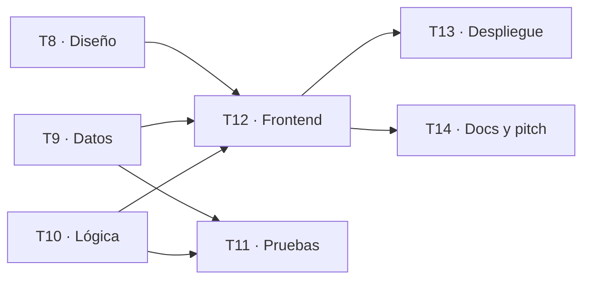

# Cómo se hizo esta demo

Guion del taller y referencia para los equipos. Recorre el flujo completo en tres actos:

| Acto | Qué muestra | Sobre qué | Tiempo |
| --- | --- | --- | --- |
| **1. De la idea al código con SDD** | Cada fase, qué se le pide a cada agente y qué archivo queda | Spec 001 · Directorio | 15 min |
| **2. Crecer y dividir el trabajo** | Una funcionalidad nueva: spec nueva, tareas de una sola área, dependencias, olas en paralelo y reparto | Spec 002 · Mi match | 15 min |
| **3. En vivo** | Una tarea real de punta a punta: issue, sub-issues por área, rama, PR, CI, merge y despliegue | Tarea T7 · WhatsApp | 15 min |

---

## Acto 0. Preparar (antes del taller)

1. En la [plantilla](https://github.com/Dav082004/WarmiInnovathon-): **Use this template** → repositorio nuevo, público.
2. `git mv -f docs/PLANTILLA-README.md README.md`: el README del equipo reemplaza al del kit.
3. Etiquetas por área con `setup/crear-etiquetas` y tablero con *Por hacer, En progreso, En revisión, Hecho* ([ISSUES-Y-TABLERO.md](ISSUES-Y-TABLERO.md)).
4. Clonar, `setup/configurar-git` y encender el MCP de GitHub en `.vscode/mcp.json`.

---

## Acto 1. De la idea al código con SDD (spec 001)

### 1. Constitución · agente Especificador

> Ayúdanos a completar docs/constitution.md. Queremos una web muy simple, sin frameworks, que cualquiera del equipo pueda entender.

Resultado: [constitution.md](constitution.md). El principio que más pesa en el código: **la lógica va separada de la vista**, para poder probarla sin navegador.

### 2. Requisitos · agente Especificador

> Queremos un directorio de mentoras para mujeres que empiezan en tecnología. Entrevístanos y escribe la spec.

El agente pregunta de una en una: quién es la usuaria, qué ve primero, cómo busca, qué pasa si no hay resultados, cómo contacta a la mentora y qué queda fuera. Resultado: [spec 001](../specs/001-directorio-mentoras/spec.md), con 7 requisitos en notación EARS.

**Para señalar en pantalla:** cada RF es una frase comprobable ("CUANDO la aprendiz elige un área, EL SISTEMA muestra solo las mentoras de esa área") y hay una sección **Fuera de alcance** con cosas reales.

### 3. Clarificación · agente QA

> Revisa la spec 001 como QA. Solo detecta, no resuelvas.

Encontró dos dudas (¿la búsqueda mira la presentación?, ¿cómo se contacta a la mentora?). Las respuestas quedaron en "Dudas abiertas" y recién entonces la spec entró a `main` por PR.

### 4. Plan y tareas · agente Planificador

> La spec 001 está aprobada. Escribe el plan y las tareas.

Resultado: [plan.md](../specs/001-directorio-mentoras/plan.md), con cada decisión y **la alternativa descartada**, y [tasks.md](../specs/001-directorio-mentoras/tasks.md), con 7 tareas que citan sus RF y tienen un "Hecho cuando" comprobable.

### 5. Desarrollo y pruebas · agente Desarrollador

> Tomé el issue #N. Implementa solo esa tarea, pruebas primero.

El agente crea la rama `N-descripcion`, escribe la prueba **con el nombre del RF**, la ve fallar, escribe el código mínimo y corre `npm test`. Así se llegó a [mentoras.js](../js/mentoras.js) y [mentoras.test.js](../tests/mentoras.test.js).

**Para señalar en pantalla:** `npm test` lista las pruebas como `RF-3: busca en el nombre ignorando mayúsculas y tildes`. La trazabilidad se lee sola: requisito → prueba → código.

### 6. PR, revisión y despliegue

> Ya terminé. Abre el PR.

El agente redacta el PR con `Closes #N` y los RF; la CI corre las pruebas. Una compañera revisa con QA (*"Ayúdame a revisar el PR #N"*) y **ella** hace el merge. El Desplegador escribió [pages.yml](../.github/workflows/pages.yml), que publica en cada merge **solo si las pruebas pasan**.

---

## Acto 2. Crecer y dividir el trabajo (spec 002)

### 7. Aparece una idea nueva

En la prueba con usuarias: *"No sé qué escribir en el buscador. ¿Qué es UX?"*. El directorio sirve a quien ya sabe qué busca, no a quien recién empieza.

La tentación es pedirle al agente "agrega un recomendador". **No.** Una funcionalidad nueva es una **spec nueva**:

> Queremos que la aprendiz responda 3 preguntas simples y le sugiramos mentoras explicando por qué. No toques código: entrevístanos y escribe la spec 002.

Resultado: [spec 002](../specs/002-mi-match/spec.md). Para señalar:

- **La numeración de RF continúa** (RF-8 a RF-12): ningún RF se repite en el repo.
- **Fuera de alcance:** "Inteligencia artificial o aprendizaje automático: las reglas son fijas y explicables a propósito". Una decisión de producto, escrita y defendible ante el jurado.
- **Privacidad como requisito**, no como promesa: "las respuestas no se guardan ni se envían".

### 8. El plan cambia el modelo de datos

> La spec 002 está aprobada. Escribe el plan y las tareas, pensadas para que cuatro personas trabajen en paralelo.

El [plan 002](../specs/002-mi-match/plan.md) decide, entre otras cosas, que la disponibilidad pasa de texto libre a `dias` + `momento` (para poder compararla), y **lo anota también en el plan 001**. Y decide que la vista del match vaya en su propio archivo (`js/vista-match.js`) para que no choque con quien haga T7 en `js/app.js`.

### 9. Tareas de una sola área, con dependencias

[tasks.md de la spec 002](../specs/002-mi-match/tasks.md) es el centro del acto. Mostrar en pantalla:

- **Ola 1:** Diseño, Datos y Lógica arrancan **a la vez**, en archivos distintos.
- **Ola 2:** Pruebas de integridad y Frontend, cuando lo anterior está en `main`.
- **Ola 3:** Despliegue y Docs.

T10 (la lógica) **no espera** a T9 (los datos): sus pruebas usan datos de ejemplo propios. Así se diseña para el paralelismo.

### 10. Issues y reparto

> Crea los issues de specs/002-mi-match/tasks.md: uno por tarea, como sub-issues de un issue madre "Spec 002 · Mi match", con su etiqueta de área. Muéstrame la lista antes de crear nada.

El Planificador muestra la lista, espera el sí y crea los issues en *Por hacer*. **No asigna a nadie.** El reparto lo decide el equipo en 10 minutos frente al tablero ([tabla de reparto](../specs/002-mi-match/tasks.md#reparto-lo-decidió-el-equipo)): cada persona lidera un área y todas abren al menos un PR.

### 11. Cobertura: la spec se vuelve pruebas

La tabla de [cobertura](../specs/002-mi-match/tasks.md#cobertura-cada-rf-y-caso-límite-tiene-su-prueba) une cada RF y cada caso límite con su prueba. `tests/datos.test.js` además protege a la ONG: si escribe un área o un día que no existe en el JSON, la CI lo marca en el PR antes de publicar.

---

## Acto 3. En vivo: la tarea T7 (compartir por WhatsApp)

T7 (RF-7) quedó pendiente a propósito. Es pequeña, toca varias áreas y recorre todo el flujo:

1. **Issue y sub-issues.** Al Planificador: *"Crea el issue de la tarea T7 y divídelo por áreas en sub-issues. Muéstrame la lista antes de crear nada."* (Diseño, Backend y datos, Pruebas, Frontend, Despliegue, Docs; el detalle está en [EJEMPLO-TAREA.md](EJEMPLO-TAREA.md).)
2. **Reparto.** Pedir voluntarias del público para tomar los sub-issues. Mover a *En progreso*.
3. **Rama y código.** Al Desarrollador: *"Tomé el issue #N. Implementa solo esa tarea, pruebas primero."* Debería agregar `armarEnlaceWhatsApp(mentora, urlPagina)` a `js/mentoras.js`, la prueba `RF-7: ...` y el botón en `js/app.js`.
4. **PR.** *"Ya terminé. Abre el PR."* Mostrar la CI corriendo.
5. **Revisión y merge.** Al QA: *"Ayúdame a revisar el PR #N."* Una persona aprueba y fusiona.
6. **Despliegue.** Pages publica solo. Probar el botón desde un celular del público.
7. **Entrega.** Al QA: *"¿Qué nos falta para la entrega?"* Ahora RF-1 a RF-12 están cumplidos y con prueba.

---

## Bonus: un cambio de idea, bien hecho

Si alguien del público propone *"que la aprendiz pueda guardar sus mentoras favoritas"*:

> Nuevo requisito: guardar favoritas. No toques código: actualiza primero la spec y muéstranos el cambio.

El Especificador debería notar el choque con la spec 002 ("las respuestas no se guardan") y **preguntar** en lugar de decidir: ¿se guardan solo en el celular? ¿cambia la promesa de privacidad? Primero la spec (RF-13), luego una tarea y su issue, y recién después el código.
