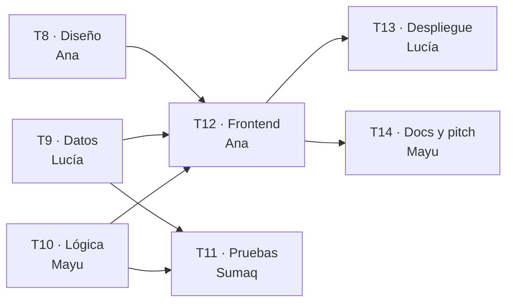

# Tareas: Spec 002 · Mi match

> Escritas por el agente **Planificador**. Cada tarea es **de una sola área** y se vuelve **un issue**, agrupado como sub-issue del issue madre *"Spec 002 · Mi match"*.
> **Quién toma cada una lo decidió el equipo** en la reunión frente al tablero, no la IA.

## Las tareas

- [x] T8. **Diseño.** Boceto de las 3 preguntas y del resultado: opciones grandes para el dedo, razones con ✓, dónde va el foco. (RF-8, RF-11, RF-12) · Issue: #
      Hecho cuando: boceto aprobado en el issue y contraste 4.5:1 comprobado.
      Depende de: nada.
- [x] T9. **Backend y datos.** `data/catalogo.json`, campos `ayudaCon`, `dias` y `momento` en `data/mentoras.json`, y `textoDisponibilidad()` en `js/mentoras.js`. (RF-9, RF-1) · Issue: #
      Hecho cuando: la prueba "RF-1: la disponibilidad se lee en frase…" pasa y el directorio sigue mostrando la disponibilidad.
      Depende de: nada.
- [x] T10. **Backend y datos.** Lógica `calcularMatch()` y `recomendar()` en `js/match.js`, pruebas primero. (RF-8, RF-9, RF-10, RF-11) · Issue: #
      Hecho cuando: las pruebas RF-8 a RF-11 de `tests/match.test.js` pasan. Usa datos de ejemplo propios, así que no espera a T9.
      Depende de: nada.
- [x] T11. **Pruebas.** `tests/datos.test.js` (que el JSON real solo use áreas, objetivos, días y momentos conocidos) y prueba de RF-12. Revisar que cada caso límite de la spec tenga prueba. (RF-9, RF-12) · Issue: #
      Hecho cuando: las pruebas de datos y la de RF-12 pasan, y la tabla de cobertura de abajo está completa.
      Depende de: T9 (necesita el JSON nuevo) y T10 (necesita `recomendar()`).
- [x] T12. **Frontend.** Sección "Mi match" en `index.html`, `js/vista-match.js` y `css/estilos.css`, siguiendo el boceto de T8. (RF-8, RF-11, RF-12) · Issue: #
      Hecho cuando: el recorrido "Datos + beca + entre semana por la noche" muestra a Lucía primera, y se completa con teclado en 360 px.
      Depende de: T8, T9 y T10.
- [x] T13. **Despliegue.** Comprobar en la demo publicada el recorrido completo desde un celular. (Criterios de finalización) · Issue: #
      Hecho cuando: probado en el celular con el enlace público.
      Depende de: T12.
- [x] T14. **Docs y pitch.** README (funcionalidades y capturas) y `docs/pitch.md` con la nueva demo. · Issue: #
      Hecho cuando: README y pitch actualizados por PR.
      Depende de: T12.

## Orden de trabajo

| Ola | Tareas en paralelo | Por qué no se pisan |
| --- | --- | --- |
| 1 | T8 (Ana), T9 (Lucía), T10 (Mayu) | Cada una toca archivos distintos: boceto en el issue, `data/` + `mentoras.js`, `match.js` + su prueba |
| 2 | T11 (Sumaq), T12 (Ana) | Pruebas toca `tests/`; Frontend toca `index.html`, `vista-match.js` y CSS |
| 3 | T13 (Lucía), T14 (Mayu) | Una prueba la demo publicada; la otra escribe docs |

Mientras tanto, **T7 (WhatsApp, spec 001) puede avanzar en paralelo**: toca `js/app.js`, y por eso la vista del match vive en su propio archivo.

## Reparto (lo decidió el equipo)

Equipo ficticio de 4 personas. Cada una **lidera** un área (decide y revisa los PRs de esa área) y todas abren al menos un PR.

| Persona | Lidera | Toma | Revisa |
| --- | --- | --- | --- |
| Ana | Diseño y Frontend | T8, T12 | T14 |
| Lucía | Backend y datos | T9, T13 | T10 |
| Mayu | Docs y pitch | T10, T14 | T12 |
| Sumaq | Pruebas | T11 | T9 y la cobertura de todas |

## Cobertura: cada RF y caso límite tiene su prueba

| Requisito o caso límite | Prueba en `tests/` |
| --- | --- |
| RF-8 · máximo 3, de mayor a menor | `RF-8: muestra como máximo 3 mentoras…` |
| RF-8 · sin puntos no aparece | `RF-8: deja fuera a las mentoras que no suman…` |
| RF-9 · 3 + 2 + 1 + 1 | `RF-9: suma 3 por área, 2 por objetivo…` |
| Caso límite · área sin tildes ni mayúsculas | `RF-9: el área coincide sin importar…` |
| Caso límite · "Aún no lo sé" y "Cualquier…" | `RF-9: 'Aún no lo sé', 'Cualquier día'…` |
| Caso límite · basta un día en común | `RF-9: basta un día en común…` |
| RF-10 · empate alfabético | `RF-10: si empatan, van en orden alfabético…` |
| RF-11 · una razón por criterio | `RF-11: da una razón por cada criterio…` y `RF-11: sin puntos no hay razones` |
| RF-12 · nadie suma | `RF-12: si nadie suma puntos…` |
| Datos de la ONG bien escritos | `tests/datos.test.js` |
| Foco, teclado, 360 px | Revisión manual en el PR de T12 |
